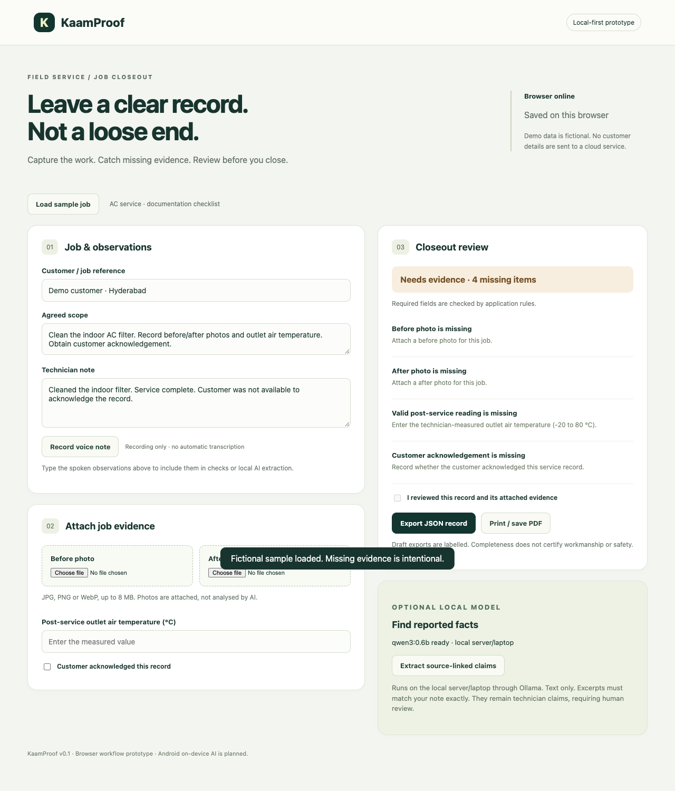
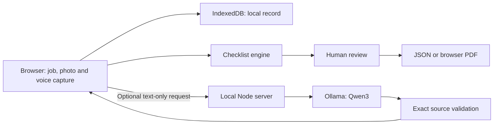

# KaamProof

**Catch missing job documentation before the technician leaves.**

A local-first job-closeout prototype for small AC-service teams. Capture photos and observations, check required evidence, review the record, and export it. Optional local AI selects source excerpts from technician notes.



> **Status:** Working browser prototype, built before the hackathon. This is not a shipped Android application. AI runs through Ollama on the local server/laptop, not on the phone. The fictional demo is not customer validation. Disclose this pre-event work when submitting.

## Try it in one minute

Requires **Node.js 22+**. The app has no npm package dependencies.

```sh
npm start
```

Open **http://127.0.0.1:4173**. Select **Load sample job**. The note says “Service complete,” but four required records are missing. Attach before/after images, enter a measured reading and record customer acknowledgement. The app changes to **Ready for review**. Approve the record and export JSON or use **Print / save PDF**.

For an explicitly synthetic walkthrough, use the labelled images in `docs/fixtures/`. They are illustrations, not service evidence.

- [Recorded walkthrough](docs/demo-walkthrough-final.webm)
- [Mobile screenshot](docs/demo-mobile.png)
- [Demo script](docs/DEMO.md)
- [Verification record](docs/VERIFICATION.md)
- [Open-source research](docs/OPEN_SOURCE.md)
- [Original Phase 1 concept proposal](docs/KaamProof_Phase1_Proposal.pdf) (written before this browser prototype)

## What actually works

| Capability | Current implementation |
|---|---|
| Job capture | Scope, observations, readings and technician-recorded customer acknowledgement |
| Photo evidence | User-selected JPG/PNG/WebP, preview and local persistence; camera capture offered on supported mobile browsers |
| Voice capture | MediaRecorder recording and playback; **no automatic transcription** |
| Completeness checks | Deterministic checks for scope, note, before/after photos, valid reading and acknowledgement |
| Review | Approval only available after required inputs are present; editing invalidates approval |
| Local persistence | IndexedDB; restored after reload |
| Offline shell | Service worker caches the app after the first successful visit; capture/checks can operate without the server |
| Local AI | Ollama text-only excerpt selection; exact source quotes validated before display |
| Export | JSON containing the evidence record; browser print layout for PDF, including images |

**Not implemented:** Native Android inference, image understanding, automatic speech recognition, Telugu/Hindi quality validation, Office Kit integration or measured Office Kit usage, cryptographic proof of completion, CRM, payments, multi-user sync and production authentication.

Photos and readings are supplied by the technician. Their truth is not independently verified. Completing the checklist does not certify safety, workmanship or actual service performance. Customer acknowledgement is recorded by the technician; it is not an authenticated customer signature.

## Optional local AI

Install [Ollama](https://github.com/ollama/ollama), then provision the small model:

```sh
ollama pull qwen3:0.6b
npm start
```

Select **Extract source-linked claims**. The server calls only `http://127.0.0.1:11434/api/chat`. Model provisioning requires internet; provisioned inference does not use a cloud API. The note leaves the browser for your local server/laptop. Audio and photos are not sent to the model.

To select another installed Ollama model:

```sh
OLLAMA_MODEL=your-installed-model npm start
```

The code asks for JSON excerpts, rejects missing or invented source quotes, and uses the exact quote as displayed text. It deliberately discards model paraphrases: the initial smoke test produced a mismatched paraphrase/quote pair. Exact text matching avoids that particular failure; it does not establish truth or ensure every relevant fact is extracted. All excerpts require human review.

There is no hidden AI simulation. If Ollama is absent, offline or fails validation, the UI shows the error and the manual workflow remains available.

## Architecture



The demo uses native browser APIs and a small Node HTTP server. React Native/Kotlin with LiteRT-LM remains the proposed Android path in the Phase 1 document. The browser prototype validates the workflow without pretending that native integration is complete.

## Repository map

```text
public/               Responsive UI, capture, IndexedDB, print and service worker
src/core.js           Shared checklist, source validation and report generation
server.js             Local static server and Ollama adapter
test/                 Node tests for evidence and source-validation behaviour
docs/                 Research, disclosure, screenshots, video and proposal
.github/workflows/    CI: syntax checks and core tests
```

## Verification

```sh
npm run check
npm test
```

The verification record reports the actual checks performed, including browser uploads, missing-to-reviewed transitions, offline reload and a real local model call. It does not claim hardware benchmarks or validated detection accuracy. CI is supplied but has not run on GitHub because the remote repository has not yet been created.

## Data and operating limits

- No analytics, external fonts, cloud inference or automatic outbound sending.
- App server binds to loopback only. Do not expose its unauthenticated inference adapter publicly.
- Browser storage is not encrypted by this app; private browsing, quota limits and browser clearing can lose records. Export a backup before replacing a record.
- One current job per browser. No import/recovery workflow or team sync yet.
- Images are limited to 8 MB each. Audio clips stop at 60 seconds and are limited to 8 MB each.
- Microphone access requires permission and HTTPS or localhost. Real device camera/microphone behaviour still needs testing.
- Offline availability requires a successful first visit and service-worker installation. Optional server inference is unavailable when browser networking is offline.
- Exported records contain supplied images and audio. Review before sharing customer information.

## Originality, licences and pre-existing work

This repository was authored with AI coding assistance before the event. Its application code and synthetic fixtures were created for this proposal; no third-party field-service application was copied. External models and runtimes have their own licences. See [disclosure](docs/DISCLOSURE.md) and [open-source comparison](docs/OPEN_SOURCE.md).

No open-source licence for this application's code has been selected by the team yet. See `LICENSE`. Public GitHub visibility alone is not a reuse licence. The team should choose a licence before inviting external reuse.

## Next build gate

Test the documentation checklist with an actual service owner and run one extraction on the intended Android device. Then integrate the device runtime. Avoid expanding into a full service-management platform before those two checks.
